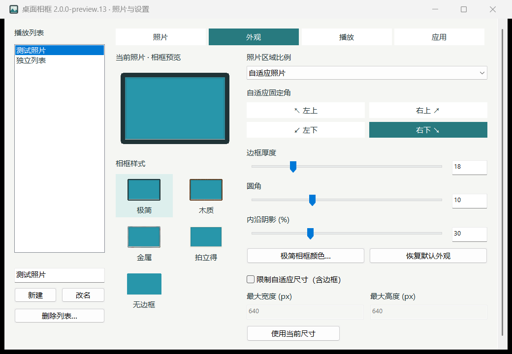

# 桌面相框原生版

Windows 桌面照片相框，使用 C++、Win32、Direct2D、DirectComposition 和 WIC；不加载 Electron 或浏览器内核。

**[下载 2.0.0-preview.13 安装包](https://github.com/ggbo13/desktop-photo-frame-native/releases/tag/v2.0.0-preview.13)** · Windows x64 · 中文界面

当前为预览版，尚未完成全部真实系统 DPI、跨屏目视和长期性能验收。



## 可以做什么

- 添加照片和文件夹，按播放列表独立保存来源、顺序、随机模式、间隔和外观；文件夹更新后追加新照片。
- 选择极简、木质、金属、拍立得或无边框，调整等宽边框、圆角、内沿阴影及照片区域比例。
- 随横竖照片自适应大小，固定四角之一，限制最大尺寸，拖动边缘或四角缩放，吸附屏幕边缘。
- 使用淡入淡出、水平滑动、缩放或无动画；滚轮和方向键切图，双击查看大图。
- 在独立设置窗口中搜索、排序、批量排除和恢复照片；通过系统托盘控制播放、切换列表、显示、隐藏及退出。
- 登录自启、单实例、锁屏和全屏暂停、电池供电时禁用动画，以及图形设备失效后的单次受控恢复。

原图保留在原位置。移除来源、排除照片或删除播放列表均不会删除原图。配置存放在 `%APPDATA%\DesktopPhotoFrameNative\settings.json`，旧 Electron 版配置另行保留。

## 基本操作

右键相框或系统托盘图标打开菜单。相框没有悬浮工具栏。

| 操作 | 功能 |
| --- | --- |
| 鼠标滚轮 / 左右方向键 | 上一张、下一张 |
| 空格 | 暂停、继续 |
| S | 打开照片与设置 |
| 双击照片 | 查看大图 |
| Esc | 隐藏相框；在大图中则关闭大图 |
| 托盘 → 退出 | 结束程序 |

照片管理中，单击选择，Ctrl/Shift 多选，双击或 Enter 播放。Alt + ↑ / ↓ 调整选中照片顺序。

## 本版本修复

preview.13 阻止自动化测试、性能测试及故障注入注册系统托盘图标。测试启动器强制 `--no-tray`，在启动前拒绝不支持隔离的旧版本；恢复子进程继承隔离状态。正常使用保留一个托盘图标。

历史检查同时核验实时 Shell 图标和资源管理器实际使用的登记视图，无法核验时明确失败，不把普通 HKCU 查询中的零记录当成通过。真实托盘登记测试仅允许在独立 Windows 测试账户运行。**本程序不会自动清空 Windows 托盘历史或删除其他应用记录。**

## 从源码构建

需要 Windows x64、PowerShell 7、Python、Windows 自带 `tar`，以及 [LLVM-MinGW 20260908 UCRT x64](https://github.com/mstorsjo/llvm-mingw/releases/tag/20260908)。解压后应存在：

```text
native/toolchain/llvm-mingw-20260908-ucrt-x86_64/bin/clang++.exe
```

工具链 ZIP 的 SHA-256：`1bcf74d06b724aeecaa6412ca85f5b26fb1da770e7cdcefa9263c9c5c3ad34b6`。

在仓库根目录执行：

```powershell
python -m pip install --target native/toolchain/build-python-20260923 cmake==4.4.3 meson==1.12.1 ninja==1.13.0
pwsh -NoProfile -File native/build-codecs.ps1
pwsh -NoProfile -File native/build-app.ps1 -OutputDirectory native/out/2.0.0-preview.13-delivery -Release
```

解码器源码归档随仓库提供，构建脚本先检查 SHA-256，再按需解压。可通过 `-PythonExecutable` 指定 Python 路径。`-Release` 去掉调试符号；不传该开关则保留开发调试信息。

如需生成安装包，安装 [NSIS 3](https://nsis.sourceforge.io/Download)，然后执行：

```powershell
pwsh -NoProfile -File native/build-installer.ps1 -MakensisExecutable 'C:\Program Files (x86)\NSIS\makensis.exe'
```

程序日常播放不依赖网络。准备工具链和 Python 构建依赖时需要联网。

## 测试

先构建，再在已解锁的 Windows 桌面会话中执行：

```powershell
pwsh -NoProfile -File native/tests/run-regression.ps1
pwsh -NoProfile -File native/tests/installer-smoke.ps1
```

可用 `run-regression.ps1 -Executable native/out/其他构建目录/DesktopPhotoFrameNative.exe` 指定待验收程序。测试数据写入被 Git 忽略的 `native/artifacts`，不使用日常配置；保留测试产物，不自动清理历史记录。更多规则见 [测试说明](native/tests/README.md)。

本次发布通过 5 组回归：版本门槛与隔离启动、4 种无托盘模式、74 项功能检查、13 项托盘命令检查、8 项设备恢复检查；另通过最终安装包的隔离安装及启动核验。真实托盘视图没有新增测试记录。

## 已知限制

- GIF、动画 WebP/AVIF 显示首帧。
- 大图预览使用 3200 万像素、最长边 8192 像素的解码预算。
- 自动化 DPI 比例模拟不能代替真实 125%/150% 系统缩放、跨屏目视和登录自启验证；部分验证仍待完成。
- 未达到正式 2.0.0 的完整动画与长期性能验收条件，不承诺固定内存数字或所有设备上的帧率。

## 目录与许可

`native/src` 是原生应用及早期性能样机源码，`native/package` 是安装器资源，`native/tests` 是测试工具，`native/vendor` 保留随附依赖及其许可证。构建输出、工具链、照片、个人配置、注册表备份与本机诊断记录不进入仓库。

项目沿用原项目的 MIT 许可声明；第三方组件按各自许可证分发，见 [THIRD_PARTY.md](THIRD_PARTY.md)。
